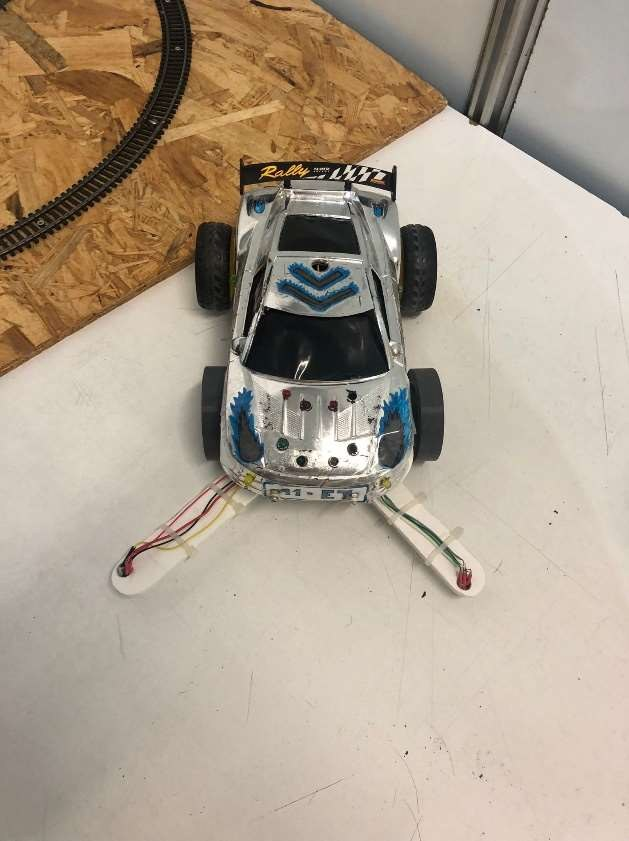
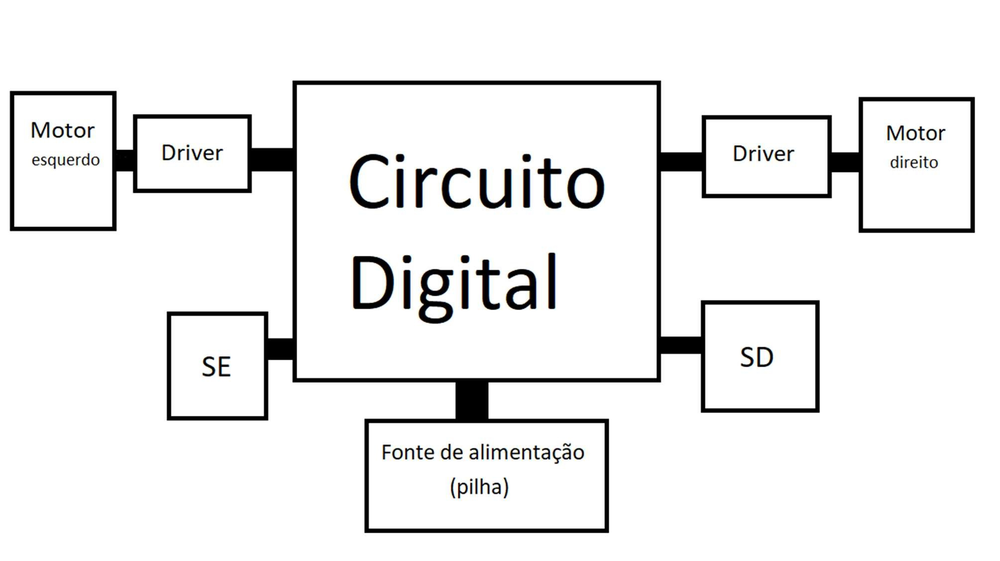
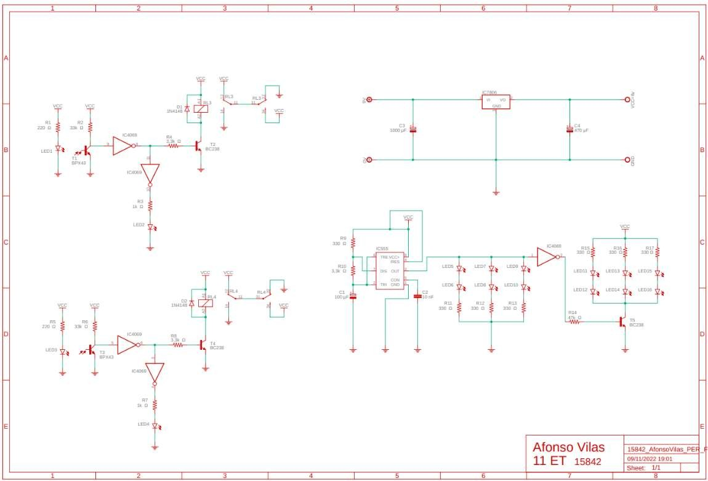
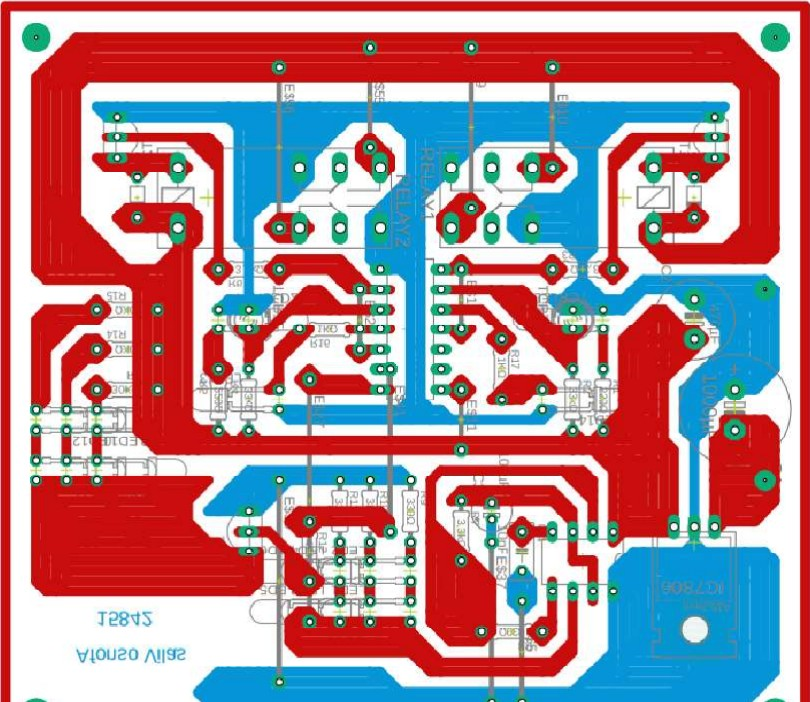
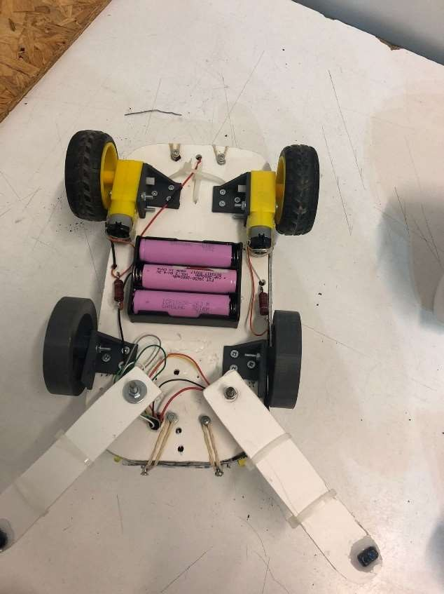
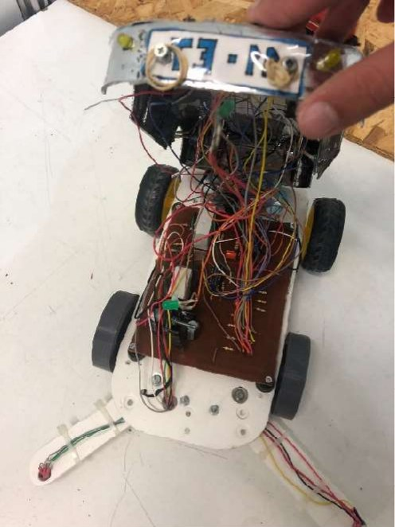

# Line-Following Robot
 
A small robot car that follows a track on its own using **infrared sensors** and a **custom printed circuit board (PCB)**, with no microcontroller: all the logic is done with analogue and digital electronics.
 
Project for the **Electronics and Robotics Projects** course of the upper-secondary programme in Electronics and Telecommunications at Colégio Internato dos Carvalhos, Portugal, 2022/2023 (11th grade). Presented at the school's ExpoCic exhibition.
 

 
## How it works
 
- Two **TCRT5000 infrared sensors** at the front of the car detect whether there is a reflective surface (the track) underneath.
- While both sensors detect the track, both motors run forward.
- When one sensor loses the track, the **opposite motor runs backwards** (left sensor → right motor, right sensor → left motor), turning the car back onto the track.
- When the car turns, a **yellow LED** lights up on that side, like a car's turn signal.
- A separate circuit makes **12 LEDs blink**, alternating between a green group and a red group, while the robot is running.

 
*Block diagram (labels in Portuguese): left/right motors, drivers, digital circuit, left/right sensors (SE/SD) and battery power supply.*
 
## Electronics
 
| Component | Role |
|---|---|
| 2 × TCRT5000 | Infrared sensors that detect the track |
| CD4069 (hex inverter) | Processes the sensor signals and alternates the LED groups |
| NE555 timer | Generates the timing for the blinking LEDs |
| 3 × BC238 transistors + 2 relays | Drive the motors in forward and reverse |
| 7806 voltage regulator (with heat sink) | Reduces the 12 V battery supply to 6 V for the circuit |
| 2 DC motors | Drive the rear wheels |
| 14 LEDs (2 yellow, 6 red, 6 green) | Turn signals and blinking lights |
| Diode | Protects the circuit if the batteries are connected the wrong way round |
| 3 × 4 V batteries | 12 V power supply |
 
Total cost of the electronic components: about €16.
 
## Development
 
1. **Circuit design in Eagle:** first the schematic, then the board layout for the PCB.
2. **PCB manufacturing:** the layout was transferred to a copper board, which was then etched in acid.
3. **Assembly:** components soldered to the PCB and the circuit tested with the teacher until it worked correctly.
4. **Mechanical build:** the body and base of an existing robot car were reused. The PCB was mounted inside, the motors and rear wheels underneath, and the front wheels and motor mounts were 3D-printed. The LEDs were fitted into holes drilled in the car body.
| Schematic | PCB layout |
|---|---|
|  |  |
 
| Underside: batteries, motors and wheels | Inside: PCB and wiring |
|---|---|
|  |  |
 
## Challenges and lessons learned
 
- **PCB etching:** leaving the board too long in acid corroded some of the copper tracks, which later caused faults.
- **Soldering:** a few poor solder joints let wires come loose, and some wires soldered in the wrong place damaged components that had to be replaced. This taught us how to test a circuit step by step to find where a fault is.
- **Limited space:** the car body was small, which made the wiring tight and loose connections more likely. A larger chassis would make the robot more reliable.
## Skills developed
 
- Circuit design (schematic and board) in Eagle
- PCB design and manufacturing
- Soldering and circuit testing
- Building a physical model for an electronics project
- Teamwork and problem solving
## Repository contents
 
- `report/` – project report (in Portuguese)
- `images/` – diagrams and photos of the robot
## Credits
 
- Project developed by **Afonso Vilas** and **Nuno Teixeira**.
- Report written by Afonso Vilas.
- Supervised by teachers at Colégio Internato dos Carvalhos.
 
